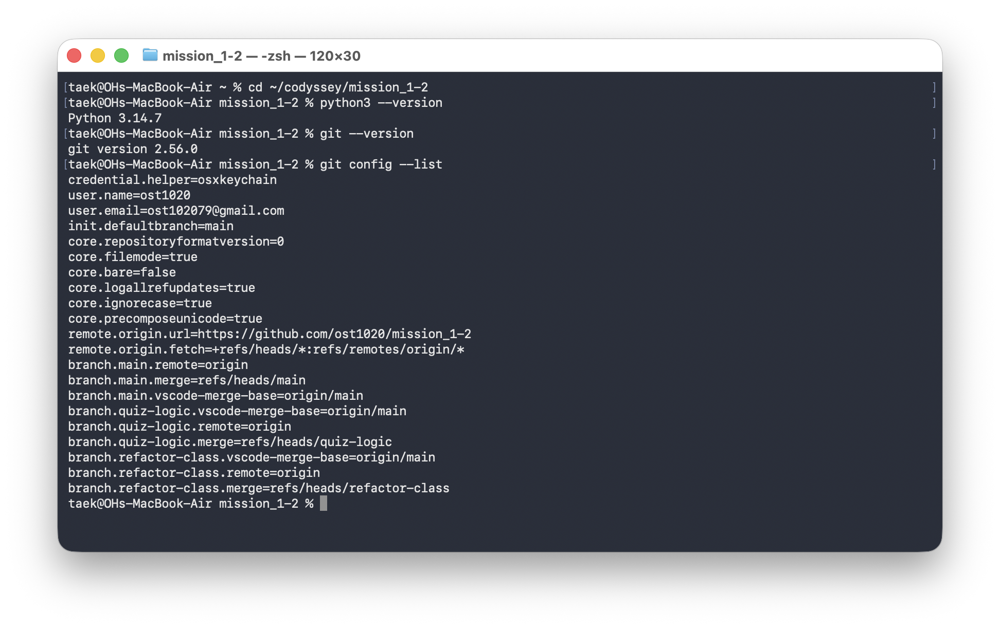
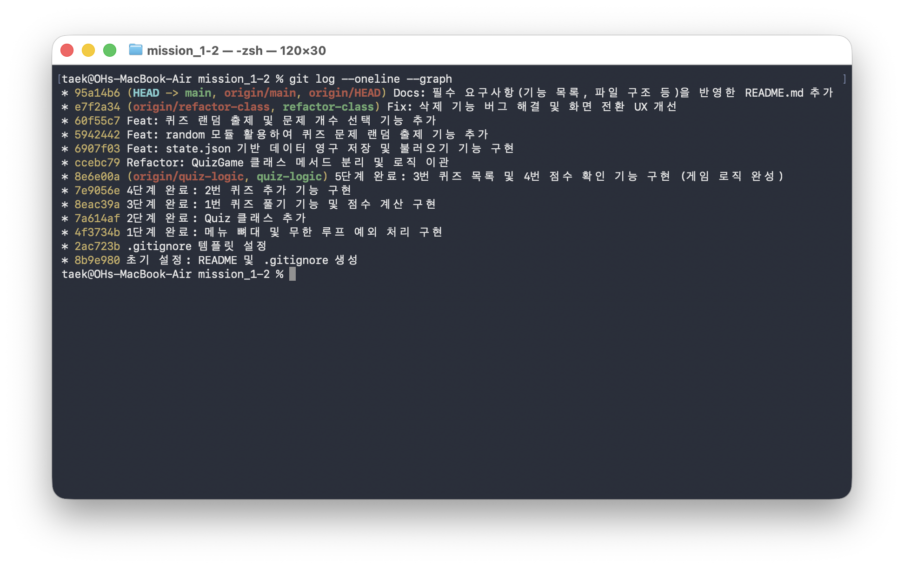
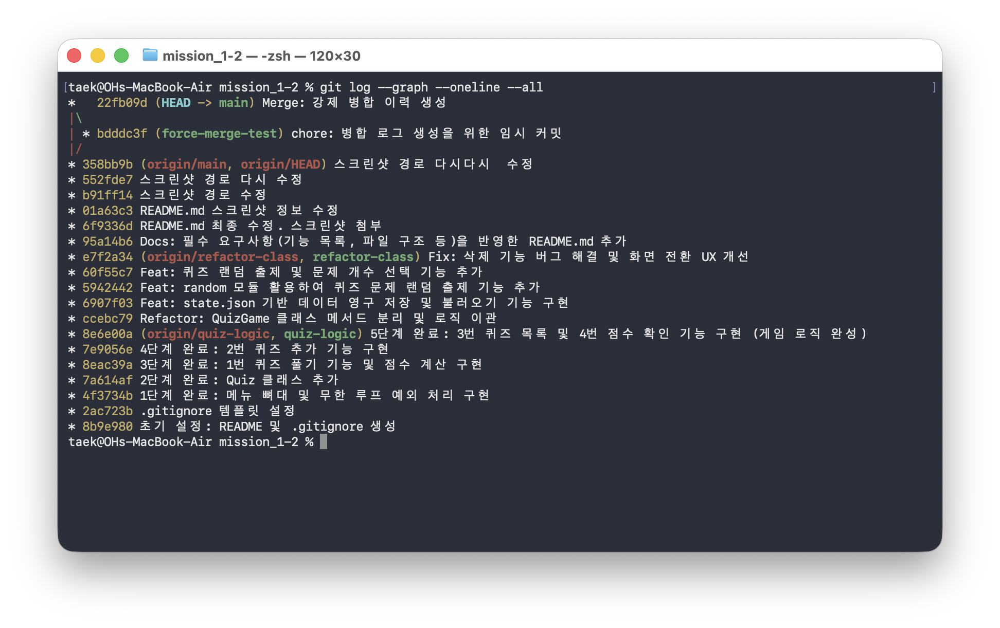
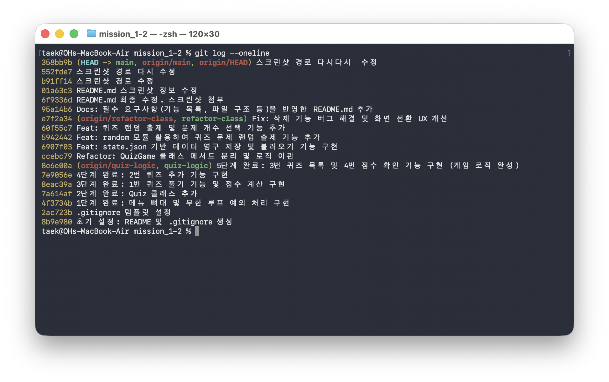
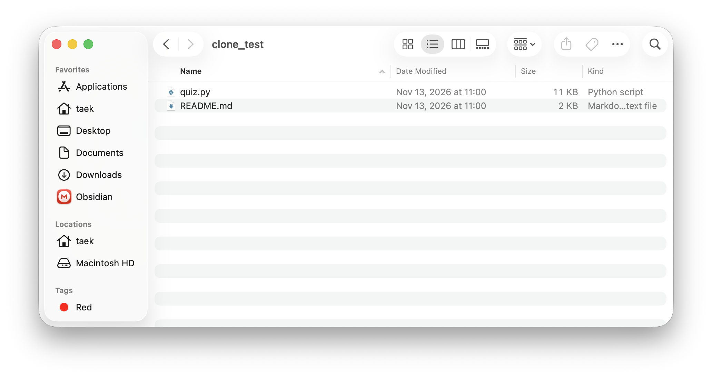
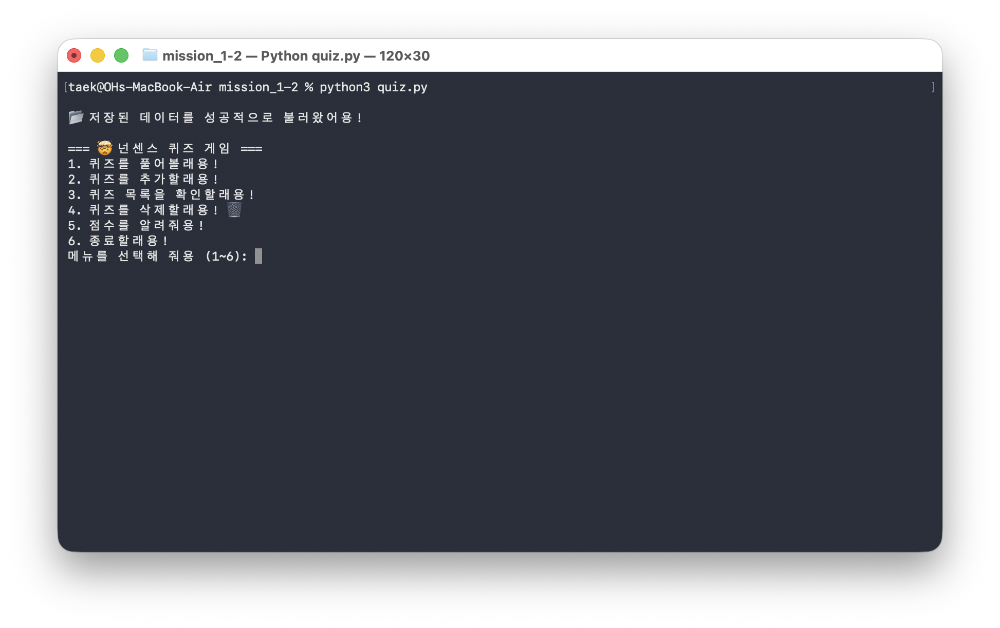
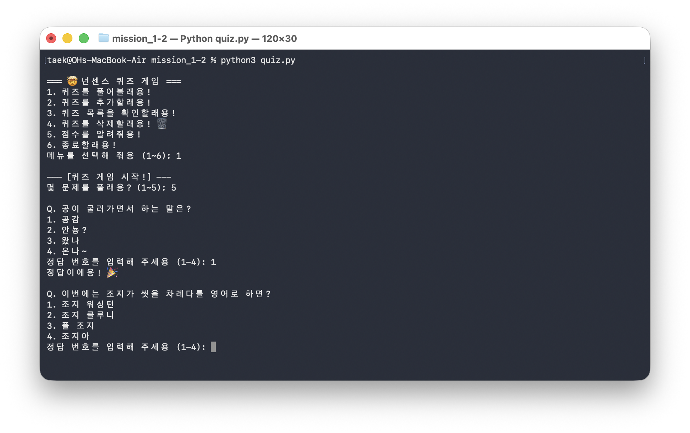
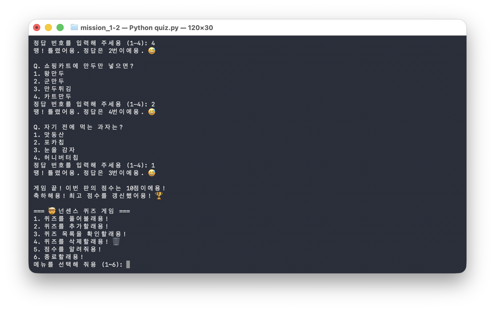
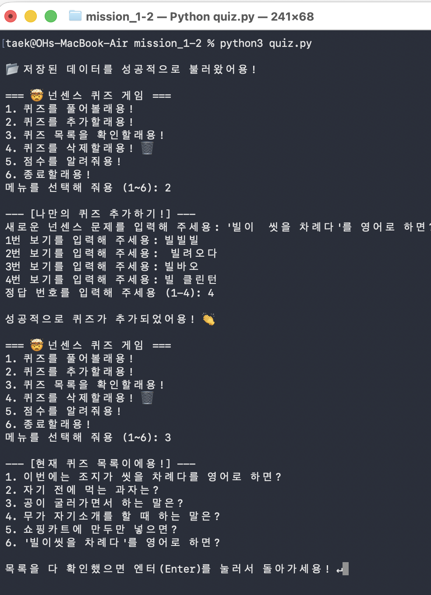
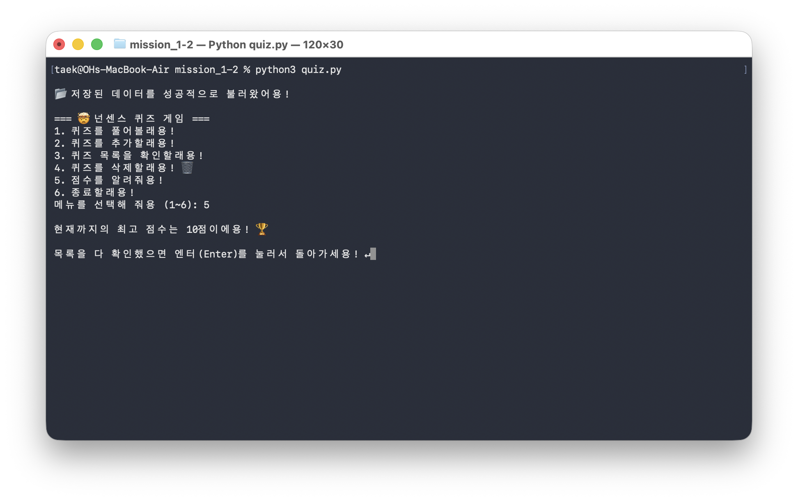

# 🤯 넌센스 퀴즈 게임 (Nonsense Quiz Game)

## 📖 프로젝트 개요
터미널 환경에서 가볍고 재미있게 즐길 수 있는 객체지향(OOP) 기반의 파이썬 넌센스 퀴즈 프로그램입니다.

## 🤔 퀴즈 주제 선정 이유
딱딱한 지식 테스트보다는, 누구나 한 번쯤 웃고 넘어갈 수 있는 유쾌한 '아재개그/넌센스'를 주제로 선정하여 사용자에게 재미를 주고자 했습니다.

## 🚀 실행 방법
파이썬(Python 3)이 설치된 환경에서 아래 명령어를 터미널에 입력하여 실행합니다.
```bash
python quiz.py
```

## ✨ 기능 목록
1. **퀴즈 풀기:** 원하는 문제 개수를 선택해 랜덤하게 출제된 퀴즈를 푸는 기능
2. **퀴즈 추가:** 사용자가 직접 새로운 넌센스 문제와 보기를 등록하는 기능
3. **퀴즈 목록:** 현재 저장된 전체 퀴즈 리스트를 조회하는 기능
4. **퀴즈 삭제:** 불필요한 퀴즈를 선택하여 삭제하는 기능
5. **점수 확인:** 역대 최고 점수(Best Score)를 확인하는 기능

## 📂 파일 구조
```text
mission_1-2/
├── quiz.py              # 퀴즈 게임 메인 실행 파일
├── state.json           # 퀴즈 목록과 최고 점수가 영구적으로 저장되는 데이터 파일
├── README.md            # 프로젝트 설명서
└── docs/
    └── screenshots/     # 실행 화면 스크린샷 폴더
        ├── menu.png
        ├── play.png
        ├── add_quiz.png
        └── score.png
```

## 🏗️ 시스템 아키텍처 및 클래스 설계 목적

**객체지향 도입 이유 (추상화 및 재사용성)**
전역 변수 오염을 막고, 데이터(상태)와 로직(행위)을 캡슐화하여 향후 다른 퀴즈 게임에서도 쉽게 재사용할 수 있도록 클래스 구조를 채택했습니다.

* **`Quiz` 클래스의 책임:** 개별 퀴즈의 문제, 보기, 정답 데이터를 담고 있는 순수 데이터 모델 역할입니다.
* **`QuizGame` 클래스의 책임:** 게임의 전체 흐름 제어, 사용자 입력 검증, 점수 계산, 파일 입출력(상태 관리)을 총괄하는 컨트롤러 역할입니다.
* **메서드 호출 흐름 (설계 의도):** 프로그램 시작 시 `load_data()`가 파일에서 상태를 복구하고, 상태 변경이나 게임 종료 시 `save_data()`를 명시적으로 호출하여 데이터의 영속성을 보장합니다.

---

## 💾 데이터 파일 설명 (`state.json`)
게임 내 데이터 상태 보존을 위해 프로젝트 루트 경로에 위치하는 JSON 포맷 파일입니다.
- `best_score`: 플레이어의 역대 최고 점수 (정수형)
- `quizzes`: 퀴즈 객체들의 배열. 각 퀴즈는 `question`(문제), `choices`(4지선다 보기 배열), `answer`(정답 번호) 필드 구조를 가집니다.

## 💾 데이터 관리 및 성능 최적화 방안

* **JSON 채택 이유 (가독성 및 호환성):** 데이터 구조를 텍스트로 쉽게 확인할 수 있어 디버깅에 유리하고, 파이썬 객체와의 매핑 효율이 좋아 직렬화/역직렬화에 아주 적합합니다.
* **대량 데이터 처리 방안 (1000개 이상):** 현재는 List 자료구조를 사용하나, 향후 데이터가 방대해질 경우 검색 속도(O(N)) 저하를 막기 위해 SQLite 같은 RDBMS나 인덱싱 기반의 딕셔너리 구조로 전환할 계획입니다.
* **요구 변경 영향도 분석 (점수 로직):** 점수 배점이나 계산 로직이 변경될 경우, `QuizGame` 내부의 점수 계산 메서드와 저장 로직 부분만 수정하면 되며 다른 UI 출력 모듈에는 영향을 미치지 않습니다.
* **요구 변경 영향도 분석 (데이터 모델/스키마):** 퀴즈 객체에 '힌트(hint)'나 '카테고리' 등 새로운 데이터 속성(스키마)이 추가될 경우, 1) `Quiz` 클래스의 `__init__` 파라미터, 2) `QuizGame.load_data()`의 JSON 파싱 로직, 3) `QuizGame.save_data()`의 딕셔너리 직렬화 로직 세 곳을 동기화하여 수정해야 합니다. 또한 기존 JSON 파일과의 호환성 에러를 막기 위해 `dict.get('hint', '기본값')` 형태의 하위 호환 방어 로직이 필요합니다.

---

## 📌 깃 커밋 컨벤션

프로젝트 유지보수 및 이력 추적을 위해 아래 커밋 메시지 템플릿을 준수합니다.

* `Feat`: 새로운 기능 추가
* `Fix`: 버그 수정
* `Docs`: 문서 (README 등) 수정
* `Refactor`: 코드 리팩토링 (기능 변화 없음)

## 📸 실행 화면 스크린샷

### 개발환경



### 깃허브 관련

#### 커밋 이력



#### 브랜치 그래프 및 병합



#### 클론 제작




### 메인 메뉴


### 퀴즈 플레이



### 퀴즈 추가


### 최고 점수 확인

